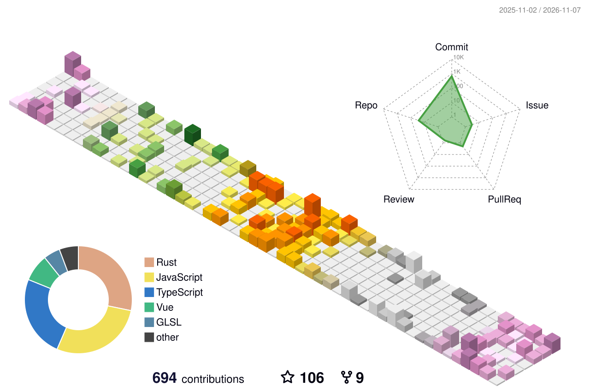

  
  <h2 align="center">Vincent</h2>
  
:clap: Coding for fun ^_^ :clap:

  

Personal website: <a href="https://blog.vince-g.xyz" 
              target="_blank">Click Here</a>
  

   
  <h1 align="center"> 
       
  </h1>
  <!-- Gif -->
  

    
    
    
    
    
    
    
  

  
  

    
  

### OS

### Skills

#### Languages/Frameworks

#### Tech Stacks

#### Editor/IDE

#### Others

### Gaming

# Visits

> [!NOTE]
> The number has been reset when I changed the link....

# Streak

  

